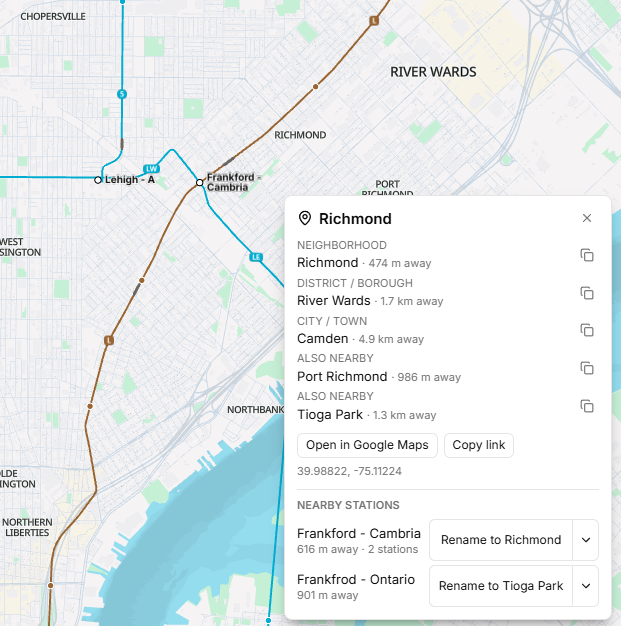
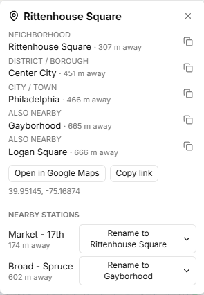

# Area Lookup for Subway Builder

**Find the neighborhood, district and city names anywhere on the map, so you can name your stations after them.**

Subway Builder only shows some place names, and which ones depends on how far
you're zoomed in. Area Lookup lets you click any spot and see the names around
it, even the ones the game is hiding.



## Install

Requires Subway Builder **1.3.0 or later** (the desktop app).

1. **Download** `area-lookup-v1.0.0.zip` from the
   [latest release](https://github.com/bookwork123/subway-builder-area-lookup/releases/latest).
2. **Find your mods folder.**
   - **Windows:** press `Win + R`, paste `%APPDATA%\metro-maker4\mods` and press Enter.
   - **macOS:** usually `~/Library/Application Support/metro-maker4/mods`
   - **Linux:** usually `~/.config/metro-maker4/mods`
3. **Unzip** it into the mods folder. You should end up with an `area-lookup`
   folder with `manifest.json` directly inside it:

   ```
   mods/
   └── area-lookup/
       ├── manifest.json
       ├── index.js
       └── ...
   ```

4. **Restart** Subway Builder, open **Settings → Mods**, and turn on **Area Lookup**.

## Use



1. Click the **map pin** button in the toolbar. Your cursor turns into a crosshair.
2. **Click anywhere on the map.** A panel shows the nearest neighborhood,
   district/borough and city/town, plus other nearby neighborhoods.
   - The **copy icon** next to a name puts it on your clipboard.
   - **Open in Google Maps** opens that spot in your web browser, so you can learn more about the area.
   - **Nearby stations** lists your stations within 1 km. **Rename to …**
     renames a station after the neighborhood closest to it (station
     groups are renamed as a whole). Click the **▾** arrow next to it to pick
     another nearby name, or **Edit name…** to type your own. Changed your
     mind? Click **Undo** within 5 seconds.
3. **Esc** closes the panel. Press **Esc** again (or click the map pin) to turn
   lookup mode off.

While lookup mode is on, clicks on the map only look up names; they won't build
or select anything. Dragging still moves the map.

<br clear="right">

## Good to know

- **It shows the closest name, not exact boundaries.** The game's map stores
  each place name as a single point, so near a border the closest name may
  belong to the neighborhood next door. The distance shown helps you judge this.
- **No neighborhoods listed?** Zoom in a little and click again. The game only
  loads neighborhood names once you're zoomed in far enough.
- **Works offline.** Names come from the map data the game has already
  downloaded, and nothing is sent anywhere.

## Troubleshooting

- **No map pin button:** make sure the mod is enabled in Settings → Mods and
  that you restarted the game. Check that `manifest.json` is directly inside
  `mods/area-lookup/` and not in an extra nested folder.
- **Open in Google Maps doesn't open a browser:** the link is copied to your
  clipboard instead. Paste it into your browser.
- **Mod stopped working after a game update:** renaming uses parts of the game
  that aren't officially documented, so an update can break it.
  [Open an issue](https://github.com/bookwork123/subway-builder-area-lookup/issues)
  and it'll get fixed.

---

## For developers

### Dev setup

Link the repo into the game's mods folder so your edits are live (Windows,
no admin needed):

```powershell
New-Item -ItemType Junction -Path "$env:APPDATA\metro-maker4\mods\area-lookup" -Target "<path to this repo>"
```

Then restart the game (or reload mods) after each change.

### Packaging a release

Bump `version` in `manifest.json`, then run:

```powershell
./package.ps1
```

This builds `dist/area-lookup-v<version>.zip` with an `area-lookup/` folder
ready to attach to a GitHub release.

### How it works

- Mods run in the game's renderer and talk to it through `window.SubwayBuilderAPI`
  ([modding docs](https://www.subwaybuilder.com/docs)). The toolbar button uses
  `ui.addToolbarButton`; the map is the raw MapLibre instance from `utils.getMap()`.
- Names come from the basemap's place-label layers (`neighborhood_labels`,
  `suburb_labels`, `city_labels`) via `map.querySourceFeatures`, so labels the
  game hides because of zoom or overlap are still found.

## License

[MIT](LICENSE)
